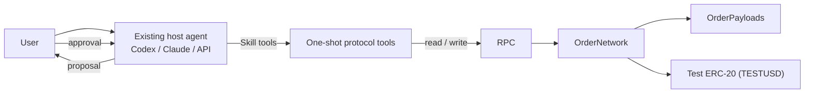
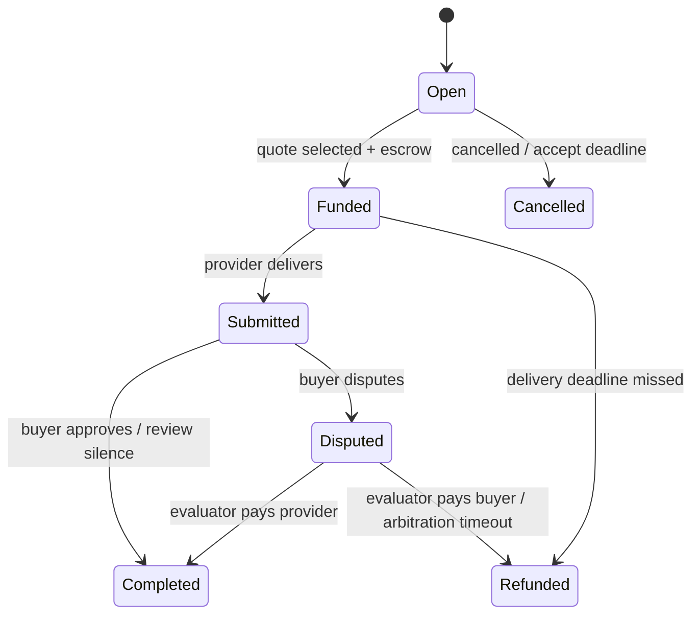

<div align="center">


# Agent Order Network

**Skill-first peer-to-peer on-chain orders for existing AI agents.**

[](https://github.com/skchen17/agent-order-network/actions/workflows/preview.yml)
[](LICENSE)
[](package.json)
[](#validation-status)

[Quick start](#quick-start) · [How it works](#how-it-works) · [Scope](#v06-scope) · [Validation](#validation-status) · [Documentation](#documentation) · [简体中文](README.zh.md)

</div>

> **Developer preview.** v0.6 is feature-frozen. Real funds are not approved. Base mainnet tooling is opt-in and unaudited; no mainnet transaction has been sent. Public testnet deployment and real cross-device trading are not yet verified. Read [Known limitations](docs/known-limitations.md) and [Mainnet readiness](docs/mainnet-readiness.md) before using anything here.

## What this is

This project lets a user's existing agent — Codex, Claude, or an API-driven host — understand a complex request, author a public on-chain order, discover and filter orders, and complete a peer-to-peer trade. The user makes the trading decisions in the original conversation. Integration is a **`p2p-orders` Skill plus one-shot JSON protocol tools**, not a new client and not another model.

Orders and public terms live in smart contracts. Quotes, escrow, delivery, and settlement are written to and read from the chain by the participants. Orders are not tokens or NFTs; `TESTUSD` is a valueless test payment token. The project does not operate accounts, directories, matching, file, model, or wake servers. Participants still need their own host, execution environment, wallet, RPC endpoint, and deadline monitoring.

## Why this design

- **The host does the thinking.** The user's agent turns natural language into clauses, reads full order terms, and explains candidates. The project ships protocol tools, not a model.
- **The chain enforces the money.** Public order state, signed quotes, escrow, deadlines, settlement, and withdrawals are enforced by an immutable contract with no administrator.
- **The user makes the decision.** The agent prepares an exact proposal; the user selects a provider, confirms escrow, and approves delivery. The chain cannot verify semantic quality, so human review stays explicit.
- **Participants self-host.** Wallets, state, indexes, and schedulers belong to the participants. There is no project-operated always-on server.

## At a glance

| | |
| --- | --- |
| Integration | `p2p-orders` Skill + one-shot JSON tools |
| Networks | Local `31337`, Base Sepolia `84532` testnet, and opt-in Base mainnet `8453` with USDC (unaudited; real-funds gates apply) |
| Payment | `TESTUSD` on testnets; canonical Base USDC on mainnet |
| Order model | Public orders, EIP-712 signed quotes, escrow, bounded disputes |
| Host verified | Codex CLI on one machine; Claude and other hosts are not yet verified |
| License | MIT |

## How it works



1. The host agent turns the user's request into structured public terms and validates them with `draft_order`.
2. The buyer publishes the order on-chain after explicit confirmation. The order is public from publication.
3. A provider's agent discovers the full order, quotes a price and delivery deadline, and signs an EIP-712 quote.
4. The buyer selects a quote and locks the exact amount in escrow in one transaction.
5. The provider delivers a hash plus a public URI. The buyer reads it from the chain, verifies the hash, and approves or disputes.
6. Settlement credits the beneficiary; the recipient withdraws only their own balance, scoped to specific orders or an explicitly authorized all-balance withdrawal.

### Order lifecycle



## Quick start

Requires **Node.js 24+**, npm, and a terminal. The first install needs access to npm. The default self-test does not need a model account, wallet, test gas, or public RPC.

```sh
npm ci
npm run preview:verify
```

`preview:verify` runs contract compilation, the automated test suite, the full Skill tool demo, and standalone Skill packaging in order. It stops on the first failure. The demo starts a temporary local chain and stops the chain process it started. Data goes to the ignored `.local-demo/` directory, which contains random development wallets. Do not upload that directory.

If Windows PowerShell blocks `npm.ps1`, use `npm.cmd` instead.

## Full demo

```sh
# Complex order -> paginated discovery -> quote -> confirmed escrow -> delivery -> payment approval -> per-order withdrawal
npm run demo:skill

# Inspect the tool definitions
node skills/p2p-orders/scripts/orders.mjs schema

# Build a Skill package that can be moved outside the repository
npm run package:skill
```

The demo should end with the main order at status `4` (Completed), the seller balance at `1500000` (1.5 TESTUSD with 6 decimals), and escrow and pending credits both at `0`.

Requirement understanding, user authorization, and delivery in the automated demo are test fixtures. The demo verifies the protocol loop, not model capability. See the [validation record](docs/codex-live-trial.md) for real-session results.

## Connect an existing agent

Place the generated `p2p-orders` folder in a Skill location supported by the host, then install the runtime dependencies inside the package:

```sh
npm --prefix "<Skill directory>/runtime" ci --omit=dev
node "<Skill directory>/scripts/orders.mjs" schema
```

The host reads [SKILL.md](skills/p2p-orders/SKILL.md) and runs the tools in the user's own environment. Public discovery can use a deployment manifest that contains no private key. Trading requires the participant's own test wallet and real authorization. A host that can only complete text and cannot execute tools cannot trade using the Skill text alone.

## Repository layout

```text
contracts/        OrderNetwork, OrderPayloads, test payment tokens
src/              protocol runtime and one-shot tool implementation
skills/           p2p-orders Skill, references, and executable entry points
scripts/          compile, local chain, demo, packaging, trial harnesses
test/             contract, protocol, recovery, pilot, and host tool tests
docs/             design, limitations, validation, and pilot runbooks
examples/         example demand, capabilities, and invitation template
```

## v0.6 scope

| Capability | Delivered |
| --- | --- |
| Requirement expression | Host-generated terms with required items, exclusions, conditions, deliverables, and acceptance criteria; tools validate and preserve the original text |
| Public discovery | Wallet-free paginated reading of full orders; the host interprets candidates; tag matching is an optional coarse filter |
| Human-confirmed trading | Exact proposal previews; quotes, escrow, delivery, approval, disputes, and withdrawals scoped to listed orders or an explicit all-receivable authorization |
| Receipts and recovery | Per-step receipts, durable action journal, wallet write lock, read-only recovery after disconnects, and duplicate-proposal checks |
| Inbox and wake | Durable event inbox, deadline reminders, one-shot local adapter, and receipt verification in the original Codex session |
| Standalone onboarding | Test identities, invitation verification, doctor, explicit Base Sepolia configuration, deploy/claim tooling, and evidence export |

Out of scope for v0.6: a mandatory proprietary client, a business token, mainnet real-funds operation (the opt-in Phase 1 tooling is not approval), production custody, cross-product plug-and-play, bulk-search promises, and expanded automated acceptance.

## Validation status

| Area | Status |
| --- | --- |
| Local complete trade, recovery, inbox, and wake | Verified |
| Two real Codex sessions trading on one machine | Verified |
| New-session onboarding and original-session wake | Verified |
| Base Sepolia public deployment | Not performed; tooling ready |
| Two physical devices | Not yet verified |
| Claude or other host compatibility | Not yet verified |
| Base mainnet tooling | Phase 1 only; no deployment; unaudited |
| Mainnet real funds | Not approved until readiness gates close |

The automated demo uses fixtures for requirement understanding, authorization, and delivery. It does not measure model quality or cross-host behavior.

## Security model

- The order contract has **no administrator, no upgrade path, no protocol token, and no protocol fee**.
- Quotes are **EIP-712 signatures** bound to the chain ID, contract, order, terms, price, and delivery deadline.
- Escrow is a single ERC-20 per deployment. A balance-delta check rejects fee-on-transfer tokens. Credits are tracked per order, and withdrawals are scoped to listed orders or an atomic all-balance amount plus version.
- The approval digest binds exact content, but **is not cryptographic proof of human consent**. The host must enforce the user's real authorization.
- Orders and deliveries are public and hard to retract. Do not put secrets or sensitive personal data on-chain.
- The contracts are **unaudited** and cannot be patched in place. Base mainnet is opt-in, requires an external signer, and has no deployment yet; do not use real funds until the [readiness gates](docs/mainnet-readiness.md) close. See [SECURITY.md](SECURITY.md).

## Known limitations

Public testnet deployment, cross-device trading, and other hosts are not yet verified. There is no privacy layer, delivery payloads are limited to 32 KiB, and reads depend on an available RPC. The evaluator is offline by default: review silence can pay the provider, and arbitration timeout refunds the buyer. The local action journal and wallet lock protect one machine only, not a wallet shared across devices. Matching is linear and makes no anti-spam, sybil-resistance, or million-order performance claims.

Read the full [Known limitations](docs/known-limitations.md).

## Documentation

| Document | Contents | Language |
| --- | --- | --- |
| [Developer preview guide](docs/developer-preview.md) | Install, self-test, full demo, packaging | Chinese |
| [Known limitations](docs/known-limitations.md) | Current boundaries and risks | Chinese |
| [Agent / API integration](docs/agent-skill.md) | Host integration and distribution | Chinese |
| [Tool protocol](docs/agent-tools.md) | Tool inputs, outputs, and authorization | Chinese |
| [Recovery and wake](skills/p2p-orders/references/recovery.md) | Receipts, recovery, inbox, schedulers | Chinese |
| [Real-session validation](docs/codex-live-trial.md) | Codex trial observations | Chinese |
| [Deployment checklist](docs/deployment-checklist.md) | Base Sepolia deploy, verify, invite, and drills | English |
| [Mainnet readiness](docs/mainnet-readiness.md) | Base mainnet + USDC trust assumptions, risks, and gates | English |
| [Mainnet deployment checklist](docs/mainnet-deployment-checklist.md) | Phase 1 dry run, Phase 2 gates, Phase 3 pilot | English |
| [Pilot runbook](docs/pilot-runbook.md) | Optional public-testnet pilot | Chinese |
| [Changelog](CHANGELOG.md) | Version history | Chinese |

## Brand assets

- [Logo (SVG)](docs/assets/logo.svg)
- [Logo (PNG)](docs/assets/logo.png)
- [Social preview (PNG)](docs/assets/social-preview.png)

## License

MIT. See [LICENSE](LICENSE). Third-party dependencies retain their own licenses.

---

English is the default README. A Chinese translation is available at [README.zh.md](README.zh.md).
