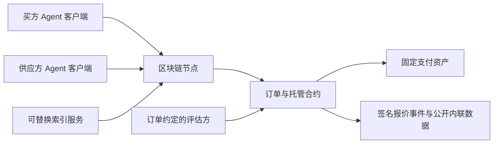
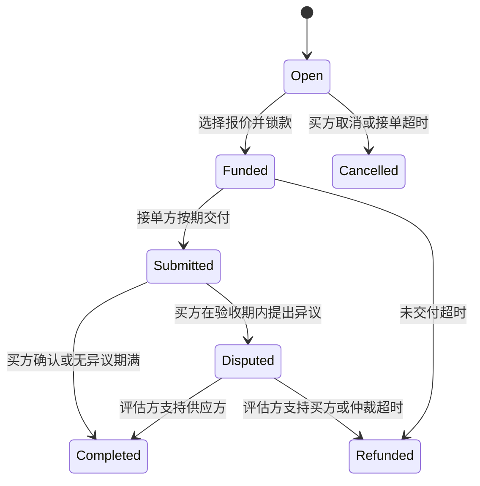

# OrderPact 协议设计

v0.1 使用不可升级的 `OrderNetwork` 合约管理多笔订单。合约存储公开需求、成交状态和货款；大文件与私密输入通过引用关联。没有管理员、业务代币、NFT 或收费配置。底层区块链负责交易排序和状态共识，不能验证任意链下交付的真实性。

## 架构



跨进程实现中，买卖方各自运行客户端进程，通过 RPC 发现订单和报价事件。小数据可内联，较大的公开 JSON 可通过 OrderPayloads 公告合约传递。供应方维护自己的 SQLite 索引，没有应用方的 HTTP 收件箱或共享结果文件。临时本地节点作为第三个进程运行，远程索引与加密存储属于后续组件。

## 角色与权限

| 角色 | 权限 |
| --- | --- |
| 买方 | 创建订单、取消未成交订单、选定报价并付款、确认交付、提出异议、提取自己的退款 |
| 接单方 | 签署报价、在期限前提交一次交付、提取自己的货款 |
| 评估方 | 仅在争议阶段决定全额放款或全额退款 |
| 任意地址 | 查询、关闭过期未成交订单、触发无异议结算、触发到期退款 |

买方、接单方和评估方地址必须彼此不同。这只能避免同地址重叠，不能证明三方在现实中独立或防止串通。供应方签名当前支持 ECDSA，尚未支持 ERC-1271。

## 数据与隐私

`Request` 的链上字段是：买方范围内唯一的 `requestId`、`taskType`、公开描述、输入 URI、验收标准、预算上限、接单截止时间、最晚交付时间、验收周期、仲裁周期、评估方。

订单另外记录买卖方、成交金额、实际交付期限、条款摘要、交付摘要与 URI、异议证据摘要及状态。创建时由 `keccak256(abi.encode(buyer, request))` 计算条款摘要；所有创建条款保持固定。

这些字段公开可读，包括预算上限。联系方式、密钥和原始私密输入不能写入描述。固定快照使用 data URI，真实网页任务清单通过 data URI 或受配置限制的 evmdata 引用传递；base64 不是加密。真实网页 URL 由单独的域名和 DNS 地址策略验证。尚未实现私密传输与密钥分发。对于外部资源，哈希不能保证其可用，也不能将错误内容变成真实内容。

OrderPayloads 接受最多 32 KiB 的公开 bytes，按 keccak256 摘要发出一次 PayloadPublished 事件，重复相同内容不重复发布。其 published 映射不包含付款权限。URI 形如 evmdata:31337:合约地址:内容摘要；客户端只读取配置允许的链和公告合约，并校验内容哈希。实际内容依赖 RPC 的历史日志服务，不能据此保证永久可下载。公告不会替代订单资金合约。

边界：描述最多 4096 字节，验收标准最多 2048 字节，引用最多 512 字节；验收与仲裁各为 60 秒至 7 天；最晚交付时间在创建后 30 天内。限制单位为 UTF-8 字节而非中文字符数。

## 状态与时间



| 操作 | 允许的时间条件 |
| --- | --- |
| 接受报价 | 当前时间严格早于订单接单截止与报价失效时间 |
| 提交交付 | 当前时间严格早于报价签署的交付期限 |
| 未交付退款 | 当前时间达到交付期限，且仍为 Funded |
| 提出异议 | 当前时间严格早于 reviewUntil |
| 无异议结算 | 当前时间达到 reviewUntil，且仍为 Submitted |
| 评估方裁决 | 当前时间严格早于 disputeUntil |
| 仲裁超时退款 | 当前时间达到 disputeUntil，且仍为 Disputed |

期限使用区块时间戳，按交易被链实际执行的时间判断。交易在截止前广播不保证能赶上截止。买方可在 Submitted 状态提前确认，验收期过后也可主动确认；一旦进入 Disputed，必须走争议规则。

超时不会自动发起链上交易，需要任意客户端或 keeper 调用对应函数；之后还需要收款方提款。后续 keeper 应支持接近期限的提醒与幂等重试。

### 明确的经济取舍

无异议期满向供应方结算，保护供应方免受买方长期沉默影响；因此买方需要在线监控。争议评估方超时则退款买方，确保资金有退出路径，但供应方可能在已交付后失去报酬。供应方签名绑定了该规则。这是小额原型的固定取舍，不构成公平性或服务质量保证；真实试点前必须验证供应方接受程度。

## 报价与防重放

供应方签署 EIP-712 `Quote(orderId, termsHash, provider, price, deliverBy, validUntil)`。

签名域为：name `AgentOrderNetwork`，version `1`，当前链 ID 和本合约地址。因此同一签名不能用于另一条链、另一份合约、不同订单或不同条款。价格和交付期限也受签名保护。第一笔成交后状态不再是 Open，重复接受会失败。

订单创建使用买方范围内唯一的 requestId 避免 SDK 重试重复发布。报价只在短有效期内有效；v0.1 没有单独撤销未过期报价的机制。

新增可选的 postQuote 公告接口：供应方自己提交其签名报价，合约复核条款、签名、预算和期限后发出 QuotePosted 事件，并记录该报价摘要以拒绝重复发布。发布不锁定供应方、不保留订单、不转移货款。买方通过事件读取报价；原 acceptQuote 也继续允许直接提交有效的链下报价。链上公告增加一次供应方 gas 支出。

买方使用一次调用选择供应方并锁款。签名不匹配、价格超预算、代币转账失败时整个操作回滚，不会留下“选中但未锁款”的订单。条款版本暂时通过不可变合约部署和 taskType 的版本名表达，修改规则应部署新合约，不能修改已有订单。

## 资金

每份合约只接受构造时确定的一种 ERC-20 资产。SafeERC20 处理标准返回值差异；入金额通过余额差校验，拒绝少到账的手续费型资产。重基准、冻结等特殊资产行为不在当前保证范围。

资金记账分两步：锁款增加 `totalEscrowed`；结算将这笔金额转到指定账户的 `credits` 并增加 `totalCredits`。只有受益人能调用 withdraw 提取自己的余额。没有任意地址提款和管理员取款接口。

v0.5同时按订单保存受益人及剩余应收额。withdrawOrders(ids)只提取所列订单；重复ID、其他人的订单或已提取订单回滚。withdrawAll(expectedAmount,expectedVersion)原子检查总额及每次结算／提款递增的creditVersion，防止预览后余额组成变化扩大授权。旧withdraw()仍可直接提取调用者全部余额，Skill不调用它。全部提款用钱包epoch使历史订单应收额失效，无需遍历所有订单；后续结算不会让历史款项复活。需部署新合约，不升级旧部署。

资金不变量：

```text
合约实际资产余额 >= totalEscrowed + totalCredits
```

外部赠款可能使余额大于负债，不自动成为运营收入，当前也没有取出多余赠款的接口。原型收取零协议费。

## Agent 接入

v0.4 的宿主指现有 Codex、Claude 或 API Agent，Skill 指导它调用 src/agent-tools.mjs 的非交互工具，自行理解需求及匹配语义。list_orders 可用公共部署描述、VoidSigner 与本地增量索引分页读全文，不依赖专用客户端或钱包；签名仅在用户授权的 execute_action 路径。摘要不是人类确认凭证，生产签名隔离仍需另建。trade CLI 和项目内 Ollama 适配仅为可选调试，不是网络接入前提。

v0.3 新增 demand.complex.v1：原文、必须项、交付物、条件分支、排除范围、能力标签、预算与期限组成公开 JSON，写入原有按内容寻址的公告合约。订单从发布起包含标题目标、人工确认约定、预算和期限；inputURI 的内容哈希随不可变条款绑定。自由文本不增加合约支付能力，分期或附条件支付若仅写在文字中不会自动生效。

TradeSession 为人类确认生成只读动作提案，展示完整需求、报价和资金规则；执行必须提交该提案的完整摘要，提案绑定部署、钱包及状态，五分钟过期，预览后状态变化需重新确认。确认码为受信任本地交互控制，不是远程鉴权或生产会话密钥策略。trade CLI 不暴露签名工具给模型；本地 Ollama 仅看到需求与 Schema。

v0.5在广播前持久化动作与交易意图，广播后立即记录哈希，确认后保存每步回执及规范区块哈希。ActionJournal用SQLite约束同一目录内钱包未决写入，恢复仅查询回执、精确nonce/calldata及当前余额，不自动重发。未知结果继续阻断；只完成部分交易时显示interrupted，交由宿主按既有用户授权重新准备。外部钱包工具或不同目录不受此本地锁控制，不是生产签名授权层。

HostInbox以区块锚点和游标补扫事件，保留未确认待办及截止提醒；重组时重建。wake入口由参与者自己的调度器调用，有待办才将JSON通过stdin交给其明确配置的宿主命令；失败与超时保留待办。至少一次投递要求宿主按eventId去重，唤醒本身不授予交易权限。无需项目方调度、账户或中继服务；机器离线时不能主动提醒，链上期限不暂停。

复杂需求匹配采用独立本地索引，从支持的任务事件增量同步，分页检查所有尚可接单记录，再按用户策略截取展示结果。不沿用旧采集客户端按预算先选20条的策略。正文缓存、本地标签过滤和复杂条件提示不需要项目方搜索服务器；当前全量匹配仍为线性复杂度，不能宣称大规模吞吐或语义理解已实现。

`src/order-client.mjs` 已提供 publish、discover、quote、postQuote、getQuotes、accept、submit。discover 通过 OrderCreated 事件筛选类型，再读取链上当前状态。客户端必须再次检查接单期限与状态，不能仅依赖索引结果。

供应方脚本使用 OrderIndex 维护本地 SQLite 订单表，不在每轮调用旧的全历史 discover。索引按任务类型分段补扫创建事件，并通过生命周期事件刷新相关订单；区块游标与订单更新在同一数据库事务提交。区块哈希不一致时全量重建，改变本地能力策略后清除排除记录并重新评估候选。

筛选先由 SQL 完成待接、截止、精确整数预算及身份约束，再读取候选任务输入做域名、页面数量和模板匹配。预算排序不是实际利润预测。尚未使用大模型排名或声誉模型，也不保证候选完整性和抢单成功。

买方保存当前订单的报价游标和候选池，报价日志扫描遇到范围限制时缩小区块跨度。公共链报价重组回滚与复杂 RPC 恢复仍需补充。

当前本地 EVM 每笔交易即时确认。公共链接入必须加入确认深度、重组回滚、分段日志扫描、RPC 限流处理和链 ID／合约／支付资产白名单。索引结果应携带区块号与区块哈希，不能作为最终付款依据。

买卖方跨进程交易已在同一电脑验证：各自钱包和状态目录，通信仅依靠链。脚本检查部署区块指纹与本地链 ID，尚未开放公共测试网配置。MCP、跨框架和跨设备联网尚未验证，见 Agent 工具接口设计及独立 Agent 测试指南。

## 验收能力边界

合约记录交付摘要和引用；小样例引用可内联实际公开内容。合约本身不能执行网页抓取或判断提取正确性，买方确认与评估方裁决是外部输入。

固定 product profile 验证供应方输出与给定快照一致；真实网页 profile 由供应方采集并由买方独立访问全部网址，比较来源、时限和商品字段。价格动态变化、网络不一致或共享解析器错误仍可能引发争议或漏检，不能视为密码学真实性证明。真实付费前需要约定人工或独立评估方的处理方式。

## 验证与后续安全工作

本地测试覆盖角色权限、条款和报价篡改、跨链及跨合约签名重放、失败入金回滚、重复接单／提款、截止边界、无交付退款、争议及评估方失联、多订单资金记账。

独立进程集成测试覆盖正常支付、买方发布后的重启与供应方锁款后的重启、未交付退款、错误价格被买方检出及争议超时退款。测试检查 PID 独立、订单及报价不重复、双方余额正确、托管与待提款负债清零。

尚未完成：第三方安全审计、恶意代币／重入对抗测试、状态机模糊测试、公共链费用与重组验证、ERC-1271、持续预算约束和生产运维。当前合约不宣称符合 ERC-8183，尤其无异议结算及争议超时规则不同。

参考：[EIP-712](https://eips.ethereum.org/EIPS/eip-712)、[OpenZeppelin SafeERC20](https://docs.openzeppelin.com/contracts/5.x/api/token/erc20)、[OpenZeppelin 密码学工具](https://docs.openzeppelin.com/contracts/5.x/api/utils/cryptography)、[ERC-8183](https://ercs.ethereum.org/ERCS/erc-8183)。
